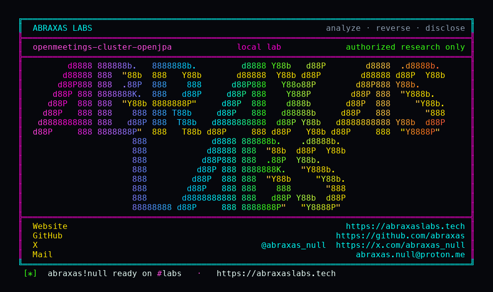

<p align="center">
  
</p>

<p align="center">
  <a href="https://abraxaslabs.tech"><strong>abraxaslabs.tech</strong></a>
  &nbsp;·&nbsp;
  <a href="https://github.com/abraxas">github.com/abraxas</a>
  &nbsp;·&nbsp;
  <a href="https://x.com/abraxas_null">@abraxas_null</a>
  &nbsp;·&nbsp;
  <a href="mailto:abraxas.null@proton.me">abraxas.null@proton.me</a>
  &nbsp;·&nbsp;
  <a href="https://github.com/abraxas/openmeetings-cluster-openjpa">openmeetings-cluster-openjpa</a>
</p>

# openmeetings-cluster-openjpa

**Class:** CWE-502
**Reach:** Remote

**Apache OpenMeetings** `9.1.0`. Leftover of [CVE-2024-54676](https://www.cve.org/CVERecord?id=CVE-2024-54676) (docs whitelist). Default `bin/startup.sh` does not set OpenJPA lists. Clustering.xml / systemd unit still document `RemoteCommitProvider=tcp`. When an admin uncomments that, TCP 5636 is unfiltered `ObjectInputStream.readObject`. Stock 9.1.0 does not bind 5636.

This lab sends `java.util.HashMap` / String only. No gadget chain.

| | |
|---|---|
| ID | no CVE yet |
| Class | **CWE-502** |
| Reach | **Remote** (when clustering TCP is enabled as docs) |
| CWE | [CWE-502](https://cwe.mitre.org/data/definitions/502.html) |
| CVSS | **High: 8.1** `CVSS:3.1/AV:N/AC:H/PR:N/UI:N/S:U/C:H/I:H/A:H` |
| Product | [Apache OpenMeetings](https://github.com/apache/openmeetings) 9.1.0 clustering |
| Auth | none on 5636 once clustering is on |
| License | [GNU Affero GPL v3.0](LICENSE) |
| Lab | `127.0.0.1:18162` only |

## What an attacker can do

| Method | Sink | Privilege |
|---|---|---|
| Stock default TCP 5636 | `startup.sh` has no lists; persistence.xml commented | **Closed on stock (lab-proven):** port closed. `PHASE_A_STOCK_NOT_EXPLOITABLE`. |
| Docs-on `RemoteCommitProvider=tcp` then TCP 5636 serialized HashMap | OpenJPA `readObject` | **Integrity (lab-proven deserialize):** `ClassCastException` HashMap vs `RemoteCommitEvent`. Witness string was in the HashMap. Gadget RCE not exercised. |

**Closed:** ysoserial not used. Default clustering off. CVE-2024-54676 docs whitelist for the *script* path; this leftover is the TCP provider the clustering doc still shows.

## Lab

```bash
cd lab
./run.sh
```

Last line: `SUCCESS OPENMEETINGS-CLUSTER-OPENJPA-WITNESS`

Suggested fix: keep `RemoteCommitProvider` off. If TCP clustering is required, bind loopback and set the OpenJPA serialization whitelist in `startup.sh`, not only systemd. Do not document uncomment-and-listen on 5636.

## Contact

Abraxas Labs - https://abraxaslabs.tech - https://github.com/abraxas - https://x.com/abraxas_null - abraxas.null@proton.me

Vendor: security@openmeetings.apache.org
